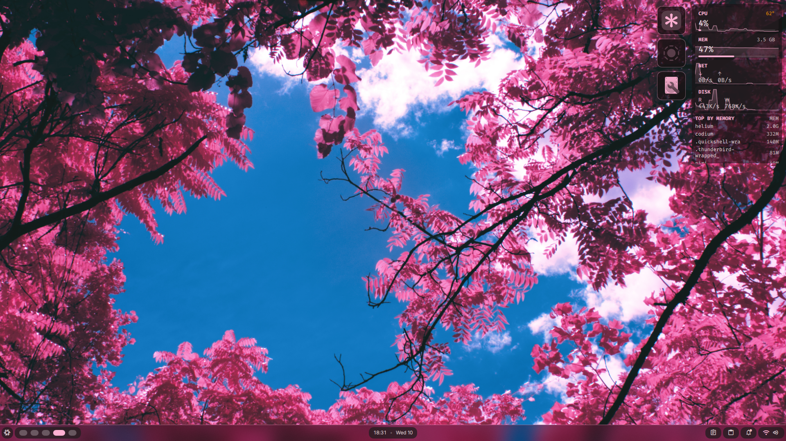

# ❄️ NixOS

My NixOS daily driver. \
Mess? Kinda. Cleaning? Working on that.



[Wallpaper](https://wallhaven.cc/w/6lqvql) / [Creator](https://wallhaven.cc/user/Trashbuff)

[](https://nixos.org)
[](https://kernel.org)
[](#boot--system-integrity)
[-blueviolet.svg?logo=nix&color=7B1FA2>)](#code-quality--tooling)
[](https://fishshell.com)
[](#desktop-environments)

## Features

### Desktop Environments

- **Niri (`minimal` profile)**: Dynamic scrolling Wayland compositor integrated with **`dux-shell`** and `wallust` dynamic theming.
  - PAM integration for `dankshell` authentication.
  - Nautilus file manager with `ffmpegthumbnailer` and GNOME Sushi previews.
  - `foot` terminal, `nomacs` image viewer, and `xwayland-satellite`.
- **KDE Plasma 6 (`fluid` profile)**: High-performance Plasma 6 Wayland desktop session.
- **Display Manager**: `silentSDDM` styled with Catppuccin Mocha.
- **GTK & Theming**: Unified `dconf`, SVG (`librsvg`) and WebP loaders, schema bridging, and base icon themes.

### Boot & System Integrity

- **Lanzaboote UEFI Secure Boot**: Active on the physical workstation (`my.security.secureboot.enable = true`).
  - Generates signed Unified Kernel Images (UKIs) via systemd-boot.
  - TPM2 hardware measurements and boot validation via `sbctl`.
- **GRUB 2 (Fallback)**: Catppuccin Mocha themed bootloader with OS Prober when Secure Boot is disabled.
- **Plymouth**: Silent boot splash screen with flicker-free Fastboot transition.

### Performance & System Tuning

- **Kernel & Scheduling**:
  - Upstream Linux Mainline kernel (`linuxPackages_testing`) with `sched-ext` support.
  - BPF-based CPU scheduling powered by `scx_loader` with **`scx_bpfland`** as the default scheduler.
  - Kernel scheduler autogroups prioritizing interactive desktop sessions over batch jobs.
- **Responsiveness & Memory**:
  - Hardware-aware I/O scheduling: Kyber latency targeting on NVMe storage to eliminate compositor stutters during builds.
  - ZRAM compressed swap with Multi-Gen LRU (MGLRU) and EarlyOOM protection shielding user sessions.
  - Periodic SSD TRIM timers.
- **Hardware Acceleration & Power**:
  - Intel Tiger Lake Iris Xe graphics acceleration with early KMS, iHD VA-API, and OpenCL compute runtimes.
  - Non-adaptive `thermald` and PCI runtime power management.

### Security Hardening

- **Firewall & Privacy**:
  - Native **`nftables`** backend with default drop policies.
  - Guest bridge isolation (`virbr0`, `waydroid0`) blocking access to private LANs.
  - Transparent loop-free NextDNS port 53 interception table.
  - Full 48-bit per-network MAC address randomization via `iwd`.
- **System Isolation**:
  - Active CPU microcode mitigations and Kernel Self Protection (KSPP memory sanitization).
  - Attack surface reduction: blacklisted legacy protocols, unmaintained filesystems, and unneeded peripheral buses.
  - Strict system umask (`077`), private home directories (`0700`), and systemd namespace sandboxing for core daemons.
- **Biometric Authentication**:
  - Gaze on-device facial authentication daemon (`services.gaze`), PAM integration (`sudo`, polkit, login), liveness detection, and GTK4/Libadwaita configuration GUI.

### Binary Compatibility & Execution

- **Dynamic Binaries (`programs.nix-ld`)**: Seamless execution of unpatched standard Linux binaries with bundled glibc, FUSE 2/3, Wayland, X11, and Mesa libraries.
- **Seamless AppImages (`programs.appimage`)**: Automatic kernel `binfmt_misc` registration running AppImages natively via `appimage-run` without manual extraction or FUSE errors.
- **FUSE Permissions**: `programs.fuse.userAllowOther = true` permitting unprivileged multi-user mounts.
- **FHS Sandbox**: `steam-run` available for running complex foreign desktop software.

### Shell & Productivity

- **Fish Shell**:
  - Two-line `starship` prompt matched to dynamic ANSI terminal palettes.
  - Plugins: `autopair`, `done`, `fzf-fish`, `grc`, and `foreign-env`.
  - Productivity aliases & abbreviations: `rfluid`, `rminimal`, `nfmt`, `ncheck`, `nclean`, `nlog`.
- **ArtCraft Creative & Office Suite**: Native apps (PdfCraft, WordCraft, DeckCraft, GridCraft, VectorCraft, PhotoCraft) via `github:Devitek/artcraft-nixos`.
- **Development & Tools**: Zed Editor, Antigravity IDE, Typst toolchain, Node.js, Bun, pnpm, Python (`uv`), Git, and GitHub CLI.
- **Browsers & Media**: Helium Browser, Mullvad Browser, Thunderbird, LocalSend, qBittorrent-enhanced, mpv, and Foliate.

### Virtualization & Specialisations

- **Lab Specialisation (`specialisation.lab`)**:
  - Podman container engine (Docker compatible).
  - Waydroid and Android development environment.
  - Libvirt / KVM hypervisor stack with `virt-manager` and SWTPM 2.0.
- **Windows Virtualization Specialisation (`specialisation.windows`)**:
  - Direct NVMe physical partition mapping (`win-vm-disk`) with zero CoW overhead.
  - UEFI OVMF with TPM 2.0 (`swtpm`), nested KVM, and FreeRDP client.
- **Gaming Specialisation (`specialisation.gaming`)**:
  - Valve Steam client with Gamescope session support.
  - Feral Interactive GameMode CPU/scheduler optimizer.
  - Steam Controller & gamepad udev hardware rules (`steam-hardware`).
  - MangoHud performance overlay and ProtonUp-Qt runner manager.

## Configuration Options

Key declarative options declared under the `my.*` namespace:

| Option                                      | Type      | Default                | Description                                                        |
| :------------------------------------------ | :-------- | :--------------------- | :----------------------------------------------------------------- |
| `my.user.name`                              | `string`  | _required_             | Primary system username.                                           |
| `my.user.shell`                             | `package` | `pkgs.fish`            | Default user shell.                                                |
| `my.desktop.environment`                    | `enum`    | `"none"`               | Desktop environment (`"niri"`, `"kde"`, `"gnome"`, or `"none"`).   |
| `my.packages.minimal`                       | `bool`    | `false`                | Omits heavy IDEs, browsers, media apps, and ArtCraft when enabled. |
| `my.packages.artcraft.enable`               | `bool`    | `!my.packages.minimal` | Enable ArtCraft office and creative suite.                         |
| `my.packages.gaming.enable`                 | `bool`    | `false`                | Enable Steam, GameMode, Gamescope, controller rules, and tools.    |
| `my.security.secureboot.enable`             | `bool`    | `false`                | Enable Lanzaboote UEFI Secure Boot with signed UKIs.               |
| `my.hardware.intelGpu.enable`               | `bool`    | `false`                | Enable Intel Iris Xe GPU drivers, early KMS, and compute.          |
| `my.hardware.powerManagement.enable`        | `bool`    | `false`                | Enable laptop power management and SATA link power policies.       |
| `my.services.nextdns.enable`                | `bool`    | `false`                | Enable local NextDNS encrypted DNS resolver.                       |
| `my.services.gaze.enable`                   | `bool`    | `false`                | Enable Gaze facial authentication daemon and configuration GUI.   |
| `my.services.printing.enable`               | `bool`    | `false`                | Enable CUPS printing and Avahi discovery.                          |
| `my.services.android.enable`                | `bool`    | `false`                | Enable Waydroid and Android development tools.                     |
| `my.services.virtualisation.enable`         | `bool`    | `false`                | Libvirt/KVM virtualization stack with QEMU and SWTPM.              |
| `my.services.virtualisation.windows.enable` | `bool`    | `false`                | Windows guest VM support and virtio drivers.                       |
| `my.users.nini.enable`                      | `bool`    | `false`                | Enable secondary user profile `nini`.                              |

## Repository Structure

```text
.nixos-config/
├── flake.nix             # Flake entry point (configurations, formatter, checks, apps)
├── flake.lock            # Lockfile managing pinned dependencies
├── treefmt.nix           # Unified formatting pipeline (RFC 166 nixfmt, statix, deadnix, shfmt)
├── LICENSE               # MIT License
├── README.md             # Workstation documentation
├── hosts/
│   ├── laptop/           # Workstation host config, hardware scan, and specialisations
│   └── preview/          # QEMU VM testing targets (preview and preview-full)
└── modules/
    ├── base.nix          # Global baseline imported across all systems
    ├── appearance/       # Styling, custom fonts, GDK Pixbuf loaders
    ├── boot/             # Lanzaboote Secure Boot, GRUB 2, and Plymouth
    ├── core/             # Options, locale, nix daemon, and binary compatibility
    ├── desktop/          # Environments (Niri, KDE, GNOME), display managers, dux-shell
    ├── hardware/         # Intel Iris Xe GPU drivers and peripheral udev rules
    ├── packages/         # ArtCraft, CLI utilities, development tools, internet, media
    ├── services/         # Virtualization, NextDNS, Android, printing, flatpaks, Podman
    ├── shell/            # Fish shell (with Starship prompt) and Nu
    ├── system-tuning/    # Performance, cgroups, disks, kernel, power, security, swap
    └── users/            # Primary user and secondary profile (nini) definitions
```

## Tooling

Code quality is enforced via [`treefmt-nix`](file:///home/mrbot/.nixos-config/treefmt.nix):

- **`nixfmt`**: Canonical RFC 166 formatting.
- **`statix`**: Nix antipattern and dead code detection.
- **`deadnix`**: Unused binding removal.
- **`shfmt`**: Shell script formatting.

```bash
# Format codebase
nix fmt       # or fish: nfmt

# Run flake checks across all systems and checks
nix flake check # or fish: ncheck
```

## Installation

### First-Time Installation

1. Mount your partitions (`/mnt` for root, `/mnt/boot` for EFI).
2. Clone this flake to `/mnt/etc/nixos/config`.
3. Generate machine hardware config:
   ```bash
   nixos-generate-config --show-hardware-config --root /mnt > hosts/laptop/hardware-configuration.nix
   ```
4. Set your username in `flake.nix` and generate password hash in `/mnt/etc/nixos/passwords/<user>`.
5. Stage changes and install:
   ```bash
   git add .
   nixos-install --flake .#minimal --root /mnt
   ```

### Daily Operations

```bash
# Rebuild and switch profiles
sudo nixos-rebuild switch --flake .#minimal    # Niri profile (or: rminimal)
sudo nixos-rebuild switch --flake .#fluid      # KDE Plasma profile (or: rfluid)

# Verify Secure Boot signatures
sudo sbctl status
sudo sbctl verify

# Switch specialisations without rebooting
sudo /run/current-system/specialisation/lab/bin/switch
sudo /run/current-system/specialisation/windows/bin/switch
sudo /run/current-system/specialisation/gaming/bin/switch
sudo /nix/var/nix/profiles/system/bin/switch-to-configuration switch

# Run configuration testing VM
nix run .#preview      # Minimal VM
nix run .#preview-full # Full VM with development & virtualization suite
```
